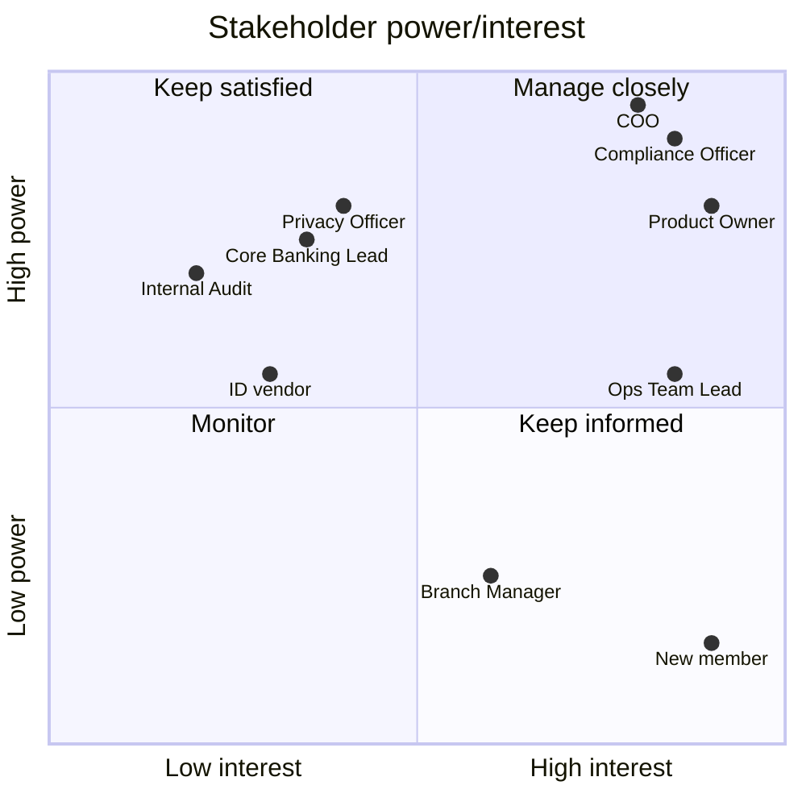

# Stakeholder Register
Version 1.0 | Status: Draft | Author: Debesh Shankhi | Updated: 02/10/2026

| ID | Stakeholder | Role in project | Power | Interest | Current → desired | Key concern | Strategy | Engagement actions |
| --- | --- | --- | --- | --- | --- | --- | --- | --- |
| SH-01 | Chief Operating Officer | Sponsor | H | H | Supporter -> Champion | Delivering visible results before the AGM; lower cost per member | Manage closely | Fortnightly 15-min status update (progress, risks, decisions needed), including bad new early with options; agree early what "visible results by the AGM" means (e.g. pilot live); escalation point for the Product Owner vs Compliance screening decision (ref. C-07, A-04) |
| SH-02 | Head of Member Experience | Product Owner | H | H | Supporter → Champion | Losing young members to digital banks | Manage closely | Daily standups, interactions and planning meetings |
| SH-03 | AML/CFT Compliance Officer | Approver (veto) | H | H | Sceptic → Supporter | Automated screening may miss edge cases; personal liability | Manage closely | Weekly 30-min design review; co-design the screening decision table; sign-off on the matching threshold (ref. A-08, R-01, C-03) |
| SH-04 | Privacy & Security Officer | Approver | H | M | Sceptic → Supporter | ID images stored offshore by a third-party vendor; collecting more personal data than needed | Keep satisfied | Review vendor shortlist privacy terms before selection; approve a privacy impact assessment; sign-off at design and vendor-selection milestones (links: C-06, A-05, R-03) |
| SH-05 | Core Banking Platform Lead | System owner | H | M | Neutral → Supporter | Overloading the nightly batch window; changes destabilising core banking | Keep satisfied | Integration design workshop; agree the interface approach (SOAP API, queueing outside the batch window); test environment access to validate A-03; check-ins at design and testing milestones (links: C-01, C-02, A-03) |
| SH-06 | Onboarding Operations Team Lead | Key user lead (6 FTE team) | M | H | Sceptic → Supporter | Changes to team roles and job security | Manage closely | Weekly check-in; team maps the As-Is process and exception cases; Ops staff lead user acceptance testing; COO briefs the team on the role redesign before design starts (links: R-05) |
| SH-07 | Branch Manager (Riccarton) | Secondary user | L | M | Neutral → Supporter | Tablet process fitting branch workflow; branches keeping credit for onboarding | Keep informed | Fortnightly update email; walkthrough of the tablet flow; branch scenarios included in testing |
| SH-08 | Internal Audit | Reviewer | H | L | Neutral → Supporter | Automated decisions without a clear audit trail | Keep satisfied | Early review of the audit trail design; controls walkthrough before go-live; access to the decision log (links: C-05) |
| SH-09 | New member (persona) | End user | L | H | Neutral → Champion | Opening an account quickly from a phone; having only a driver licence | Keep informed | Usability testing of the prototype with 5–8 under-35 participants; post-launch survey; abandonment analytics (links: A-01, A-06, R-02) |
| SH-10 | ID verification vendor | External supplier | M | M | Neutral → Supporter | Selling per-check volume; webhook capacity at peak times | Keep satisfied | Requirements written into the vendor selection criteria (NZ driver licence support, NZ/AU storage, peak volumes); contractual SLA; joint performance test before marketing campaigns (links: A-01, A-05, R-02) |

